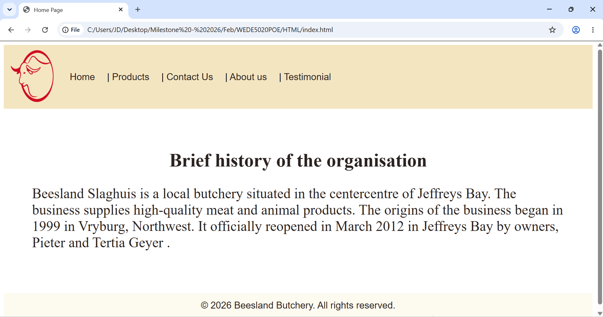
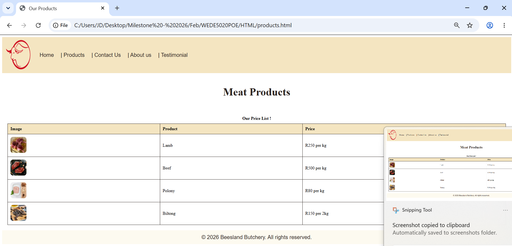
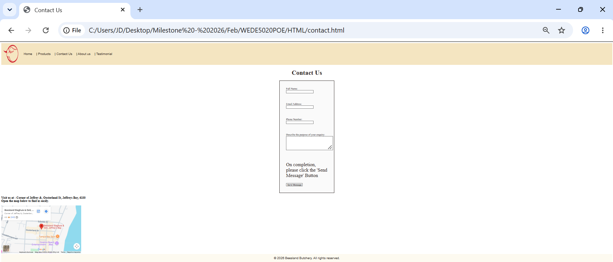
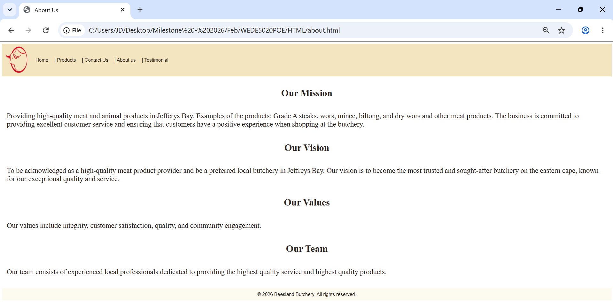
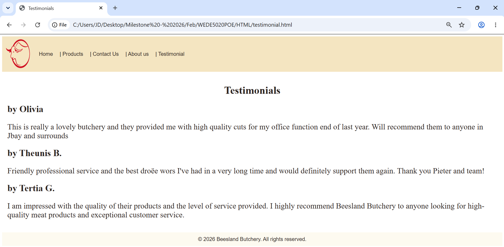

# Beesland Slaghuis Website
## About the Project
## Improvements to Part 1 Document
## Improvements to Part 1 Code
## CSS Added in Part 2
## Responsive Web Design Added in Part 2
## Screenshots of Tests

## Changelog
### Part 3 - 09 Novemeber 2026
- Implemented meta tags (description and keywords) across HTML pages
- Implemented JavaScript (folder with .js files): JQuery, LightBox, and Form Validation.
- Implmented enquiry.html page 
- Implmented FormSpree link to post each form created .
- Page is set to be live(deployed) for view in Github pages
- Updated header anchor tags to include new Enquiry HTML page.
- Lightbox gallery implementation 
- JQuery implementation

### Part 2 - 06 October 2026
- Added: css/style.css 

### Part 1 fixes - 06 October 2026
- Added: images/CSS folder
- Added: README.md and this changelog
- Added additional HTML code.

### Part 2 fixes - 09 Novemeber 2026
### Added
- Pseudo-classes: :hover, :active, :focus-visible; :focus on form inputs; :hover on images and table rows
- Font import for Inter with Arial/sans-serif fallback
- Shared .content container on all pages
### Changed
- Submit button hover no longer changes size
- Tablet paragraph size reduced to 18px
- Mobile nav centered 
### Fixed
- Unclosed <h2> in testimonial.html
- Removed duplicate CSS rules (td img, form padding)
- {IN-PROGESS, NEEDS ANOTHER LOOK AT ALL CODE DREW}Fixed heading,footer and page size inconsistencies accross individual pages
- Map iframe width , removed fix with intext CSS 
- Updated generic webpage titles across HTML files

### Part 1 - 02 September 2026
- Added HTML: Home, products, testimonials, about and contact pages

## References
Chipo, 2026. 13 Fundamental Web Design Principles for High Converting Websites. [online] Thrive Themes. Available at: https://thrivethemes.com/fundamental-web-design-principles/ [Accessed 27 Augustr 2026]. 

EarlySEO, 2026. How Many Pages Does a Website Need for SEO? [online] Available at: https://www.earlyseo.com/blogs/how-many-pages-does-a-website-need-for-seo [Accessed 27 August 2026]. 

Figma, 2026. Untitled [Design file]. [online] Available at: https://www.figma.com/design/kCqIK2RgUukqloAfjA4vKC/Untitled?node-id=0-1&t=OWjCQ4TAVgZa4UfR-1 [Accessed 30 August 2026]. 

Gupta, V., 2021. 10 Website Goals & Objectives to Set (with Examples). [online] 5MinutesSEO. Updated 19 July 2023. Available at: https://5minutesseo.com/seo/website-goals-objectives-to-set-with-examples/ [Accessed 30 August 2026]. 

LogoToUse, 2026. Logo Placement Best Practices. [online] Available at: https://www.logotouse.com/post/logo-placement-best-practices [Accessed 29 August 2026]. 

OpenAI ChatGPT, 2026n.d. ChatGPT response to "Remove Writing Logo Transparent". [online] Available at: https://chatgpt.com/share/6a96e304-ef74-83e9-bdbb-b0ee1f5a6c11 [Accessed 30 August 2026]. 

Quicksprout,2026. " How to Create a Sitemap for a Website in 5 Simple Steps ". [online] Available at: https://www.quicksprout.com/creating-website-sitemap/  [Accessed 30 August 2026]. 

Thinklocal, n.d. Beesland Slaghuis. [online] Available at: https://beeslandjbay.thinklocal.co.za/ [Accessed 7 August 2026]. 

Web Development (Introduction) WEDE5020/p/w Module Manual, 2026. The Independent Institute of Education (The IIE), First Edition. [online] Available at: https://advtechonline.sharepoint.com/:w:/r/sites/TertiaryStudents/_layouts/15/Doc.aspx?sourcedoc=%7B372D9BD7-30BB-4C4D-91B7-DC73109F0F0D%7D&file=WEDE5020MM.docx&action=default&mobileredirect=true [Accessed 7 August 2026]. 

Zaman, S., 2024. The Importance of a Testimonial for Website Success. [online] GS Plugins. Updated 17 August 2025. Available at: https://www.gsplugins.com/testimonial-for-website/ [Accessed 27 August2026].

